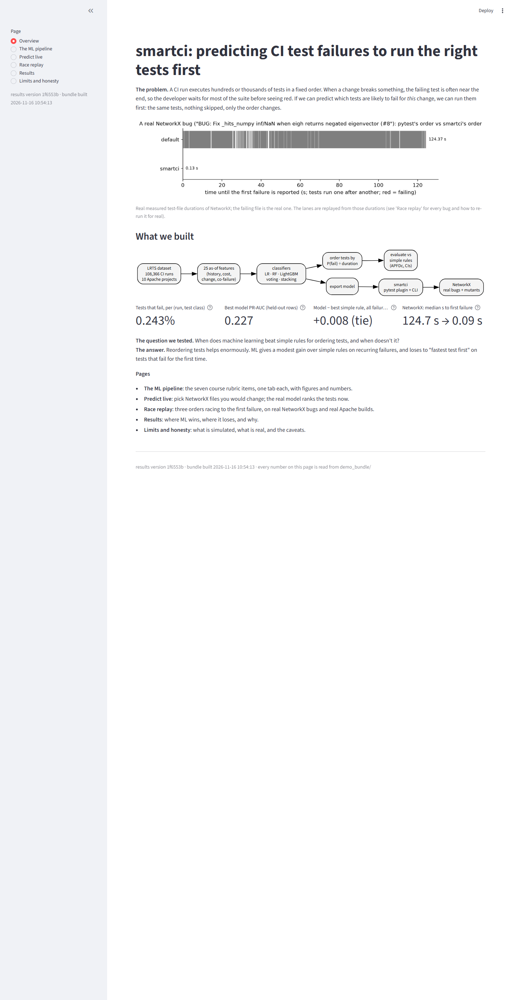

# smartci: predicting CI test failures to run the right tests first


Predict which tests will fail for a code change and run those first, so a broken change is caught in seconds instead of after the whole suite. Nothing is skipped; only the order changes.



## The result, honestly

**The question.** When does machine learning beat simple rules for ordering tests, and when doesn't it?

**The answer.** Reordering tests helps enormously. ML gives a modest gain over simple rules on recurring failures, and loses to "fastest test first" on tests that fail for the first time.

On 108,366 real CI runs of 10 Apache projects (held-out test period, APFDc: 1 = failures first, 0.5 ≈ random; 95% confidence intervals):

| Failures | Best simple rule | Its APFDc | ML (LightGBM) | ML − rule | Verdict |
|---|---|---|---|---|---|
| all failed runs | ChangedOrNewFirst | 0.863 [0.849, 0.875] | 0.871 [0.858, 0.883] | +0.008 [-0.002, +0.019] | tie |
| all failed runs | cbt_LastFail (paper's best history rule) | 0.851 [0.837, 0.864] | 0.871 [0.858, 0.883] | +0.020 [+0.008, +0.032] | ML wins |
| first-time failures of existing tests | QTF | 0.800 [0.771, 0.828] | 0.708 [0.663, 0.750] | -0.092 [-0.134, -0.053] | ML loses |

On NetworkX (318 bugs: real past bugs and synthetic mutants), the median time to the first failure is 124.7 s in pytest's default order, 0.09 s with smartci and 0.08 s with changed files first. Failures are rare: 0.243% of (run, test) pairs, so accuracy is meaningless and we use PR-AUC (best model 0.227). Why the model loses on first-time failures: [RESULTS.md §4](reports/RESULTS.md).

## Run the demo

```powershell
scripts\setup_demo.ps1     # once: .venv-demo with requirements.txt
scripts\run_demo.ps1       # http://localhost:8501, fully offline
```

Linux/macOS: `scripts/setup_demo.sh` and `scripts/run_demo.sh`. Or simply `pip install -r requirements.txt` and `streamlit run app/demo.py`. The app reads only `demo_bundle/` (committed); it needs no dataset. Memory: about 274 MB. Six pages: Overview, The ML pipeline (one tab per rubric item), Predict live (the real model ranks NetworkX tests for files you pick), Race replay, Results, Limits and honesty. Screenshots of every page: [`reports/demo_screenshots/`](reports/demo_screenshots).

## Use smartci on your own repo

```bash
pip install "smartci @ git+https://github.com/OWNER/smart-ci-tcp.git"   # into the venv you test with
smartci profile            # run your suite twice: durations, pytest's order, flaky tests
smartci learn              # mine past test-backed bug fixes and reproduce them
smartci backtest           # smartci vs simple rules on those bugs; it recommends the rule if it wins
pytest --smartci           # run your tests in smartci's order (nothing is skipped)
```

Also: `smartci compare --bug <id>` (real side-by-side pytest runs), `smartci explain`, `smartci rank --files a.py b.py` (rank for a hypothetical change), `pytest --smartci-shadow` (rank and record without reordering). The plugin does nothing unless you pass `--smartci`; if ranking fails, it keeps pytest's order. It works in git worktrees under `.smartci/` and never touches your checkout.

## How the ML pipeline maps to the course rubric

| Rubric item | Where | What |
|---|---|---|
| 1 EDA | [EDA_REPORT.md](reports/EDA_REPORT.md) | label imbalance, suite durations, history-rule collapse |
| 2 Feature derivation | [FEATURES.md](reports/FEATURES.md) | 25 as-of features, leakage tests, rejected features |
| 3 Classification | [MODELING.md §1, §4](reports/MODELING.md) | LR, random forest, LightGBM; PR-AUC |
| 4 Regularization | [MODELING.md §3](reports/MODELING.md) | L1/L2/elastic net, tree depth, early stopping |
| 5 Hyperparameter tuning | [MODELING.md §3](reports/MODELING.md) | Optuna TPE, time-ordered validation |
| 6 Ensembles | [MODELING.md §6](reports/MODELING.md) | bagging vs boosting, voting, stacking |
| 7 Performance analysis | [RESULTS.md](reports/RESULTS.md) | APFDc vs every baseline with CIs, error analysis, trade-off |

One table with the key number per item: [RUBRIC_MAP.md](reports/RUBRIC_MAP.md). Viva preparation: [VIVA_NOTES.md](reports/VIVA_NOTES.md). Demo script: [DEMO_SCRIPT.md](reports/DEMO_SCRIPT.md). Audit of every claim: [AUDIT.md](reports/AUDIT.md). Every number in the reports is generated from `reports/results/*.json` by `src/stp/reports/*`.

## Limitations

- The model was trained on Apache CI data (9 Java/Scala projects + TVM's Python suites), never on NetworkX.
- On first-time failures the model loses to "fastest first"; on a small Python repo a simple rule is as good as the model.
- NetworkX bugs are past bugs reintroduced, or synthetic mutants; race lanes replay measured durations.
- The simulated-vs-real timing check (GATE 5) was measured on battery and failed; it is pending a re-run on mains power ([REAL_WORLD.md](reports/REAL_WORLD.md)).
- On a suite of a few seconds, smartci's own start-up costs more than it saves.
- A second repository (sympy) was attempted and not completed.

## Data sources and licences

- **LRTS** (Long-Running Test Suites, ISSTA 2024): CI test results of 10 Apache projects; MIT licence. Not included in this repository; `python -m stp.data.download` fetches it.
- **NetworkX** (BSD-3-Clause): pinned commit, cloned to `external/networkx` for the live demo; not included.
- **Apache projects** (Apache-2.0): pull-request links only.

## Reproduce the research pipeline

```bash
uv venv --python 3.11 .venv && uv pip install --python .venv -e ".[research,dev]"
python -m stp.data.download && python -m stp.data.build_tables && python -m stp.data.splits
python -m stp.data.build_diffs && python -m stp.features.store && python -m stp.features.verify_store
python -m stp.baselines.lrts_repro && python -m stp.baselines.run_baselines
python -m stp.models.pipeline && python -m stp.models.figures && python -m stp.models.error_analysis
python -m stp.models.floor_tradeoff && python -m stp.models.wtl
for m in baselines_md features_md modeling_md real_world_md results_md viva_md model_card presentation_md extra_figures readme_md; do python -m stp.reports.$m; done
pytest
```

The full pipeline takes many hours and about 15 GB of disk; every stage streams per project and is resumable.

## Layout

| Path | What |
|---|---|
| `src/stp/` | research pipeline: data, EDA, features, evaluation, baselines, models, reports, demo |
| `src/smartci/` | the tool: CLI, pytest plugin, scoring, packaged model (`model/`) |
| `app/demo.py`, `demo_bundle/` | the dashboard and the only data it reads |
| `live_demo/` | NetworkX live comparison, GATE 5, Phase C timing script |
| `reports/` | generated reports, `results/*.json`, `figures/`, `demo_screenshots/` |
| `data/`, `external/` | git-ignored (LRTS data, LRTS repo, NetworkX clone) |
