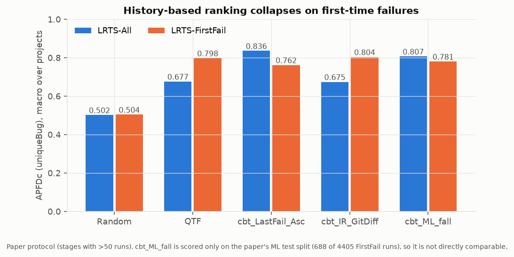

# EDA report — Smart CI Test Prioritization on LRTS

Every number below was produced by code in `src/stp/` and is stored in `reports/eda_json/*.json`; figures are in
`reports/figures/`. "Macro" means the unweighted mean of the 10 per-project values. Unless stated otherwise,
statistics use the **full processed dataset (108,366 runs)** and all data (no sampling), except Section G,
which is a sample.

---

## 1. Data inventory and audits

### What was downloaded

| Source | Content | Size |
|---|---|---|
| `external/LRTS` (git, shallow, commit `2c1b68e`) | metadata CSVs, flaky list, change stats, paper eval outcomes | 615 MB |
| Google Drive `13vnCA0…` → `long_running_test_suites.zip` | `dataset.csv`, `processed_test_result/`, `shadata/` | 3.02 GB zipped, 14.8 GB extracted |

Extracted tree (files / size): `processed_test_result/` 115,563 / 1.2 GB (one `test_class.csv.zip` per run,
Kafka 60,585 files, TVM 40,509); `shadata/` 73,962 / 12.5 GB (39,281 compare-API JSON pages + 34,676 `.diff` files;
Hive 5.6 GB, Kafka 4.6 GB).

**Schemas found**
- `test_class.csv.zip`: `testclass (str), duration (float, seconds), outcome (0 pass / 1 fail), last_outcome`. Identical
  column set in all 108,358 files read. **No execution order, no start timestamps**, and **no skip outcome**: LRTS drops
  skipped methods when it aggregates to classes, so every row is pass or fail. **Per-class durations exist** (sum of
  method durations), with 0 nulls.
- Compare JSON (`shadata/
/compare_commits/<PR>_build<N>/<trunk_sha>_<head_sha>_page<k>.json`): GitHub compare API
  with `files[]` (filename, status, additions, deletions, **`patch`**) and `commits[]` (author e-mail, message).
  **Per-file `patch` text exists for 99.9% of builds and 94.6% of changed-file entries** (macro). GitHub truncates
  very large patches: Hive is lowest at 80.9%, driven by `.q.out` golden files. A `.diff` file exists for 100% of builds.
- No `*_filterlabel` files ship in the processed data. LRTS's own first-failure labels exist only as per-run **counts**
  (`num_fail_class+first_failure`) in the repo's `metadata/dataset_filter.csv`, and I cross-checked against those.

### 108k vs 57k reconciliation

| | Rows (runs) | Failed runs | Builds `(project, pr, build_id)` | Failed builds |
|---|---|---|---|---|
| README claim | 108,366 | 49,674 | 32,199 | 22,763 |
| Drive `dataset.csv` (what we use) | **108,366** ✔ | **49,674** ✔ | 34,645 ✘ | 23,437 ✘ |
| Repo `artifact/metadata/dataset.csv` | 57,437 | 30,118 | 21,255 | 15,852 |

- The repo file is the **paper's evaluated subset**. All 57,437 of its keys are in the Drive file (0 missing), and
  pass/fail counts, timestamps and SHAs agree on 100% of them. It is **chronological**: it holds exactly the runs up to
  2023-07-29 (TVM: up to 2022-12-07; Log4j has no runs after 2022-01). The only exception is HBase, where 0.2% of runs are outside
  the subset despite predating the cut-off; no other project has any. The other 50,929 runs are a later extension (Aug 2023 – Apr 2024) that
  the paper did not evaluate.
- Runs and failed runs match the README exactly. **The README's build counts could not be reproduced.** No key
  (`pr+build_id` = 34,645, `head_sha` = 28,227, `pr+build_id+timestamp` = 56,815) gives 32,199 or 22,763. I treat
  this as a stale README figure. The README's other stats do reproduce: mean duration 6.76 h (claim 6.75), 76.0% of
  runs over 2 h (claim ≥75%), 979.5 classes per run (claim 980), 5.08 failed classes per failed run (claim 5).
- The Kafka share depends on the version: **68% of the paper subset but 49% of the full data**, where TVM is 37%
  (16% in the paper subset). Kafka + TVM make up 87% of the full data.
- `test_suite_duration_s` differs slightly between the two CSVs (median relative difference 2.8%, and 2.5% of rows
  differ by more than 10%). We use the Drive values. Note that this field is the **sum of class durations**
  (sequential CPU time), not wall-clock time.

### Count audits (`reports/eda_json/audit.json`)

| Check | Result |
|---|---|
| `dataset.csv` rows → `runs.parquet` | 108,366 → 108,366 (no rows dropped) |
| Test files vs runs | 115,528 files. **7,170 files have no `dataset.csv` row** (Kafka 7,033, Hadoop 129, Oak 3, TVM 5); they are excluded and listed in `data/interim/test_file_inventory.csv`. **8 Kafka runs have no file.** |
| Parsed rows | 104,032,648 (run, test_class) rows; 0 duplicate classes per run, 0 unknown outcome codes |
| Per-run #pass/#fail vs `dataset.csv` | **100% match for 9 projects. TVM: 33.7%.** Fail counts match on 99.93% of TVM runs, but pass counts do not. All TVM mismatches are in the post-paper extension (0% of paper-subset runs affected; 86% of 2023 and 84% of 2024 runs), where `dataset.csv` reports a median of 7 (max 206) more passing classes than the file holds. Overall match: 75.2%. The first 20 mismatches are in `audit.json`. **Decision: trust the files; do not use `num_pass_class` for TVM ≥ 2023.** |
| First-time-failure labels vs LRTS (`dataset_filter.csv`, paper subset) | Per-run count agreement 99.98%, per-run "has first-time failure" flag 99.99%. The 10 disagreeing runs are 9 Kafka runs (mostly `ppc64le:`/`x86_64:` stage names) and 1 Oak run that differs by one class. |
| Changes vs `change_stats.csv` | 99.97% of the 21,255 paper builds match on files, additions and deletions. The 6 mismatches are TVM builds that gained a second `(trunk_sha, head_sha)` pair in the extension (2,697 build rows have more than one pair). |
| Compare JSON found | 36,191 / 36,191 `(build, trunk_sha, head_sha)` pairs (100%) |

**Label definition used.** A **first-time failure** is a failing (run, test class) whose class has no failure in any
strictly earlier run, by `build_timestamp`, of the same (project, stage). History covers all 108k runs. Because the
extension only adds *later* runs, full-history labels are identical to LRTS's paper-history labels on the paper subset.
Two caveats: (i) LRTS's "FirstFail" evaluation variant additionally removes JIRA-flaky and stage-unique failures, so it
is a stricter subset of these labels; (ii) the first months of each project have no history, which inflates early
first-time rates, so Section D also reports figures after a 15% burn-in.

---

## 2. Motivation: the paper's baselines (Phase 3.A)

Mean `APFDc_uniqueBug`, macro over 10 projects. I used the paper's protocol: stages with ≤ 50 runs are dropped, seeds
are averaged per run, and runs are averaged per project. The source is `A_baselines.json`, which also holds the
per-project values; a sensitivity check without the stage filter moves no headline value by more than 0.006 (the largest shift is cbt_ML_fall on FirstFail).

| Technique | All | DeConf | FirstFail |
|---|---|---|---|
| Random | 0.502 | 0.502 | 0.504 |
| QTF | 0.677 | 0.739 | **0.798** |
| LastFail_Asc | 0.795 | 0.735 | 0.467 |
| FailCount_Desc | 0.720 | 0.613 | 0.312 |
| TestFile_FailFreq | 0.666 | 0.627 | 0.440 |
| IR_GitDiff | 0.576 | 0.633 | 0.667 |
| IR_GitDiff_tfidf | 0.589 | 0.647 | 0.691 |
| ML_f1* | 0.724 | 0.614 | 0.292 |
| ML_f3* | 0.548 | 0.593 | 0.681 |
| ML_fall* | 0.764 | 0.736 | 0.562 |
| cbt_LastFail_Asc | **0.836** | **0.835** | 0.762 |
| cbt_FailCount_Desc | 0.811 | 0.773 | 0.488 |
| cbt_IR_GitDiff | 0.675 | 0.743 | **0.804** |
| cbt_ML_fall* | 0.807 | 0.809 | 0.781 |
| **Evaluated runs** (non-ML / ML*) | 39,228 / 10,053 | 21,696 / 6,299 | **4,405 / 688** |

\*ML techniques are scored only on the paper's ML test split. On FirstFail that is 688 runs, including **1 ActiveMQ
run**, so their FirstFail numbers are not comparable to the other rows.

**In plain words.** All expected values reproduce. On all failures, "run what failed recently first, then the quickest"
(`cbt_LastFail_Asc`, 0.836) is best. On **first-time failures** the history methods do worse than random:
LastFail_Asc scores 0.467 and FailCount_Desc 0.312. The best change-aware method, `cbt_IR_GitDiff`, scores 0.804,
only **0.006 above plain QTF** (0.798). Per project it beats QTF on 7 of 10 projects by 0.004–0.030 and loses on
jackrabbit-oak, karaf and tvm. In short, nobody can currently rank first-time failures much better than "shortest test
first". The FirstFail evaluation set is also small: 4,405 runs, 62% of them Kafka, and only 45–67 runs for
ActiveMQ, Karaf and Log4j.

---

## 3. Findings B–H

**B. The problem is real (costs).** Median suite duration (sum of class durations) is 6.2 h macro, ranging from
0.22 h for Log4j and 0.30 h for Karaf to 27.6 h for Hive. Share of runs over 1 h / 2 h / 6 h: **67% / 63% / 34%**
macro (76% over 2 h pooled). Median classes per run is 1,065 macro (218 Karaf – 2,145 James). Karaf and Log4j have
almost no runs over 1 h (3% and 0%), so prioritisation saves little there.
(`B_duration_cdf.png`, `B_classes_per_run.png`)

**C. Dataset shape.** 108,366 runs, 49,674 failed, 34,645 builds, 11,605 PRs. Kafka has 53,554 runs (49%) and TVM
40,491 (37%); ActiveMQ (446) and Log4j (528) are tiny. Multi-stage projects: Kafka has 24 stages, TVM 19, HBase 4,
James and Log4j 2, the rest 1. Failed-run rate ranges from 12% (TVM) to 71% (Kafka), 44% macro. Coverage runs from
2020-07 to 2024-04, but Log4j ends in 2022-01. There are gaps inside the active span: ActiveMQ and Hive have 6 empty
months each, TVM 5, James 4. (`C_runs_per_project.png`, `C_builds_per_month.png`)

**D. Failure structure.** Failed classes per failed run: median 1–2 in every project, mean 5.3 macro, and 47% of
failed runs (macro) have exactly one failing class. The per-class failure frequency is heavy-tailed: the top 1% of
failing classes cause 12.8% of failures (macro, 25.6% in Kafka), and one Kafka class failed 6,566 times. There are
also plateaus: about 100 Jackrabbit-Oak classes each failed about 80 times, and about 10 Log4j classes 29 times.
Those are mass co-failure events, not independent bugs. **First-time failures** after a 15% burn-in:
- They are 14.6% of failing (run, class) rows, macro. Kafka and Oak are lowest at 2.8% and 2.4%; HBase is highest at 50%.
- 18.8% of failed runs have at least one first-time failure.
- **9.4% of failed runs consist only of first-time failures**, and history cannot help at all there. Per project this
  ranges from 0.8% (Hive) and 0.9% (Kafka) to 20% (Log4j) and 33% (HBase).

The absolute counts are small: 4,868 runs with at least one first-time failure in total, and 25–243 per project apart
from Kafka (1,756) and TVM (742). **Flakiness:** JIRA-listed flaky classes (267 distinct classes; the 21 method-only
Hive `[qfile]` entries cannot be mapped to a class) account for 12.2% of failures macro, 32% for Kafka and 34% for
Hive. More of these failures happen *after* the listed fix date than before it (7.6% vs 4.6% macro), so the JIRA fix
date does not mean the class stops failing. Only 3.7% (macro) of first-time failures are JIRA-flaky classes.
(`D_*.png`)

**E. Change data.** Median changed files per build is 4 macro (Karaf 1, James 7); the p90 is 26. Median changed lines
per build is 115 macro (Karaf 2, Hive 241); the p90 is 1,335. 0.7% of builds (5.7% for Hive) touch 300 or more files,
which is GitHub's per-page file cap. Patch text: 99.9% of builds, 94.6% of changed files. Median commits per build is
2 and median authors is 1, so author features carry little information. Top extensions (pooled): `.java` 54%, `.scala`
11%, `.py` 11%, `.xml` 4.5%, `.cc` 4.3%, `.out` 3.1% (Hive golden files), `.h` 2.1%. (`E_change_size.png`,
`E_extensions.png`)

**F. Is there a change signal?** I tokenised test-class names and changed-file paths (camelCase and path split,
generic and project-name stopwords removed) and measured their overlap on **all 104M (run, class) rows**.
Base rates are tiny: first-time failures are at most about 0.1% of rows. Macro lift of P(first-time fail | overlap ≥ k)
over the base rate:
- **k = 1:** 1.79×. Only 36.5% of rows overlap at all, yet those rows hold 57.6% of first-time failures (recall).
- **k = 2:** 2.98×.
- **k = 3:** 5.94×.

For repeat failures the lift is weaker (1.49× at k = 1). The signal is strongest in Kafka (10.3× at k = 3) and Karaf,
and it is **absent at k = 1 for ActiveMQ, Jackrabbit-Oak and Log4j** (lift 0.92–1.02). So a real but noisy lexical
change signal exists, and it helps first-time failures more than repeat ones. It is also what IR_GitDiff already
exploits, so a model needs more than name matching to beat `cbt_IR_GitDiff`. (`F_overlap_lift.png`,
`F_overlap_share.png`)

**G. Time to first failure — SAMPLE (≤ 300 failed runs per project, 2,664 runs, seed 42).** Sequential execution with
actual class durations; median minutes, macro:

| | Random | QTF | LastFail (cbt) | Oracle | Full suite |
|---|---|---|---|---|---|
| All failed runs | 137.8 | 58.6 | **17.3** | 0.7 | 407 |
| Runs where every failure is first-time (n = 8–111 per project) | 147.2 | **19.9** | 191.0 | 0.2 | 317 |

Compared with Random, LastFail saves a median of 79 min per failed run, and 253 min for Hive. On runs where every
failure is first-time, LastFail is **worse than random** (−50 min macro, −477 min Hive), while QTF saves 108 min. The
oracle gap is two orders of magnitude, so there is plenty of headroom. (`G_time_to_first_failure.png`)

**H. Split feasibility (chronological 70/15/15 by run timestamp, per project).** Split dates are in `H_split.json`;
for example, Kafka's train split ends 2023-07-07 and its validation split 2023-11-30.
- **Small test splits.** Runs with a first-time failure in the test split: Kafka 220, TVM 84, HBase 26, James 28,
  Hive 14, Hadoop 10, Oak 9, Karaf 6, ActiveMQ 2, Log4j 2. **8 of 10 projects fall below 30 and are "too small to
  evaluate alone"**; only Kafka and TVM pass. Runs where every failure is first-time are rarer still (Kafka has 3 in
  its test split).
- **Strong distribution shift.** Kafka's failure rate goes from 60% in train to **97% in test**, and its mean suite
  duration from 6.0 h to 15.4 h. In TVM, **63% of test-split classes never appear in train**; other projects are at
  0.4–14%, with a macro of 9.6%.
- **Short windows.** Log4j's val and test splits each cover about 9 days.

(`H_split_ftf_runs.png`)

---

## 4. Scope decisions (recommendations)

1. **Projects.** Train and evaluate on all 10, but **report Kafka and TVM individually** (the only projects with at
   least 30 test-split first-time-failure runs) and pool the other 8 into one "small projects" macro group for the
   FirstFail metric. Keep Karaf and Log4j for the All-failures metric only as a sanity check: their suites run in
   under 1 h (§B) and Log4j stops in 2022-01. *Evidence: §H counts, §B durations, §C coverage.*
2. **Macro vs micro.** **Macro over projects is the primary metric**, with micro reported as secondary. Kafka + TVM
   are 87% of runs, and Kafka alone is 62% of the paper's FirstFail runs, so micro would effectively be a Kafka score.
   This also matches the paper's protocol, which let us reproduce its numbers. *Evidence: §1, §2, §C.*
3. **Granularity.** **Test class.** That is the only level in the processed data: there are no method-level results
   (they are only in the Zenodo raw reports) and no execution order. Per-class durations are complete (0 nulls), so
   APFDc and time-based costs are computable. *Evidence: §1 schema.*
4. **Flaky handling.** Do not simply drop JIRA-flaky classes. Evaluate on (a) all failures and (b) FirstFail
   *excluding* JIRA-flaky classes as of the build date, which mirrors LRTS's `d_first_jira_stageunique`. Treat the
   JIRA list as incomplete (it covers 267 classes, and failures continue after fix dates). Add a
   frequent-failure/co-failure filter for the Oak/Log4j plateau events. *Evidence: §D.*
5. **Line-level diffs.** **Usable**: patch text exists for 99.9% of builds and 94.6% of changed files (81% for Hive),
   plus a `.diff` per build. Features should degrade gracefully when a patch is truncated, and cap at 300 files.
   *Evidence: §1, §E.*
6. **Split.** Use a per-project chronological 70/15/15 by run timestamp; the dates are in `H_split.json`. Because test
   splits are tiny, **also run a rolling-origin evaluation** (for example, monthly expanding windows over the last
   30% of the timeline) so the FirstFail test set grows to all post-train first-time-failure runs. Flag the Kafka and
   TVM shift explicitly and re-check TVM test-class naming before trusting "unseen class" results.
   *Evidence: §H.*
7. **Primary evaluation set and targets.** The primary set is **FirstFail**: runs with at least one first-time failure
   after burn-in, JIRA-flaky removed, with APFDc_uniqueBug macro. Targets to beat, from the paper protocol:
   - **Overall (All): ≥ 0.836** (`cbt_LastFail_Asc`).
   - **FirstFail: ≥ 0.804** (`cbt_IR_GitDiff`) **and clearly above QTF (0.798)**. Since those two differ by only
     0.006, "clearly" should mean winning on Kafka and TVM separately plus on the small-project macro, with a paired
     test across runs.
   - **Secondary metric:** median minutes to first failure (§G), where the oracle ceiling is about 0.2–0.7 min against about
     17–20 min for the best baseline.

   Our FirstFail numbers must be recomputed on our own chronological test split: the paper's numbers are
   whole-history averages over 2020–mid-2023, not held-out.

---

## 5. Open risks and contradictions with the brief

- **The TVM extension is inconsistent**: `dataset.csv` pass counts are wrong for 2023+ runs, 62% of builds have
  per-stage timestamps up to about 35 days apart (the same `pr_name/build_id` is reused across Jenkins jobs), and 63%
  of test-split classes are unseen in train, which suggests test naming changed. The build key needs care for TVM.
- **Kafka's test period is abnormal** (97% failure rate, 2.5× longer suites). This could be a real CI regime change or
  a collection artefact; it needs a look before Kafka results are trusted.
- **Test-suite duration is summed class time, not wall-clock.** Parallel CI makes real savings smaller than §G
  suggests, so §G minutes are an upper bound.
- **The FirstFail sample is small and heavy-tailed.** Some projects have fewer than 10 test runs, so project-level
  claims will be noisy. Use bootstrap confidence intervals.
- **Brief vs reality:**
  - `gdown --id` no longer exists in gdown 5.x; the ID must be passed positionally.
  - `flaky_tests.csv` has a column `flaky_test`, not `test`, plus `url` and `inspection_source`. Its entries mix
    class, `Class#method` and method-only formats.
  - "Kafka ≈ 68% of all runs" holds only for the paper subset (49% of the full data).
  - The README build counts (32,199 / 22,763) do not reproduce.
  - The processed data carries no `*_filterlabel` files; LRTS labels exist only as per-run counts.
  - The dataset has 108,366 runs, but 115,528 result files.
  - ML baselines are evaluated on a much smaller split than the other techniques.
- **Environment:** the host has 15.7 GB RAM with about 2 GB free, which is why table building streams. The change
  parse was I/O-bound and was interrupted by a machine sleep, but it finished completely: 36,191 of 36,191 builds.
